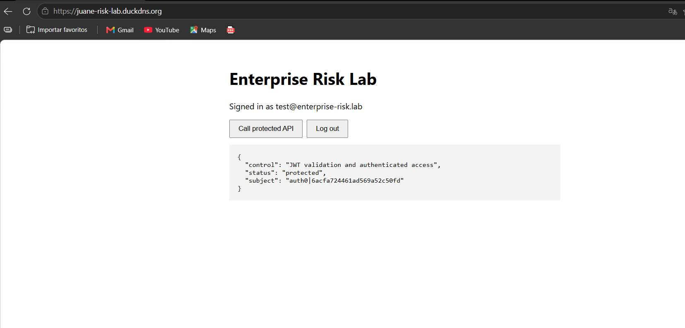
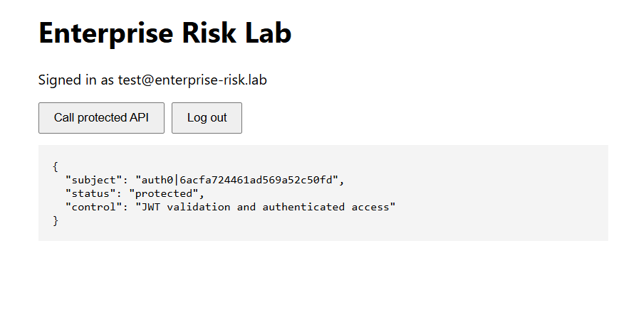

# Enterprise Risk Lab

Secure web system: React SPA + Auth0 + Spring Boot OAuth 2.0 Resource Server, published over HTTPS (Duck DNS + Apache + Let's Encrypt).

**Deployed URL:** https://juane-risk-lab.duckdns.org

## Structure

| Path | Content |
|------|---------|
| `backend/` | Spring Boot 4 (Java 21) API. `GET /api/risk-status` requires a valid Auth0 JWT; `/actuator/health` is public; everything else is denied. |
| `frontend/` | Vite + React SPA using `@auth0/auth0-react`. |
| `deploy/` | systemd unit and Apache virtual host. |
| `docs/` | Evidence screenshots (authenticated call, certificate). |

## Run locally

Backend (`backend/`):

```bash
# PowerShell: $env:AUTH0_ISSUER_URI="https://YOUR_TENANT.us.auth0.com/"
export AUTH0_ISSUER_URI=https://YOUR_TENANT.us.auth0.com/
./mvnw spring-boot:run
curl -i http://localhost:8080/api/risk-status   # -> 401 without token
```

Frontend (`frontend/`): copy `.env.example` to `.env.local`, fill in the Auth0 domain and client ID, then:

```bash
npm install
npm run dev   # http://localhost:5173
```

## Configuration

| Variable | Where | Example |
|----------|-------|---------|
| `AUTH0_ISSUER_URI` | backend | `https://YOUR_TENANT.us.auth0.com/` (https and trailing slash required) |
| `AUTH0_AUDIENCE` | backend | `https://enterprise-risk-api` |
| `CORS_ALLOWED_ORIGINS` | backend | `http://localhost:5173,https://juane-risk-lab.duckdns.org` |
| `VITE_AUTH0_DOMAIN` / `VITE_AUTH0_CLIENT_ID` / `VITE_AUTH0_AUDIENCE` / `VITE_API_URL` | frontend | see `frontend/.env.example` |

## Evidence

### Authenticated API call

A test user signs in through Auth0, the SPA obtains an access token for the audience `https://enterprise-risk-api`, and `GET /api/risk-status` returns the protected payload with the token subject.

Production, over HTTPS at https://juane-risk-lab.duckdns.org:



Local development (`http://localhost:5173` → `http://localhost:8080`):



Without a token the same endpoint is rejected:

```
$ curl -s -o /dev/null -w "%{http_code}\n" http://localhost:8080/api/risk-status
401
```

### Valid certificate

Let's Encrypt certificate for `juane-risk-lab.duckdns.org`, verified from outside the server (full output in [`docs/certificate.txt`](docs/certificate.txt)):

```
subject=CN=juane-risk-lab.duckdns.org
issuer=C=US, O=Let's Encrypt, CN=YE2
notBefore=Oct 14 15:24:38 2026 GMT
notAfter=Jan 12 15:24:37 2027 GMT
Verify return code: 0 (ok)
```

## Deployment

| Item | Value |
|------|-------|
| Server | AWS EC2 `t3.micro`, Ubuntu 24.04 LTS, Elastic IP `98.95.98.193` |
| DNS | Duck DNS `juane-risk-lab.duckdns.org` |
| Security group | 22 from the administrator IP only, 80 and 443 public |
| Host firewall | `ufw`: OpenSSH + Apache Full only |
| Backend | systemd `enterprise-risk-api`, user `riskapi`, bound to `127.0.0.1:8080` |
| Apache | `deploy/enterprise-risk.conf` (HTTP → HTTPS redirect), `deploy/enterprise-risk-le-ssl.conf` (SPA + `/api/` reverse proxy) |

## Verification checklist

- [x] Unauthenticated requests to `/api/risk-status` return 401.
- [x] A logged-in user can call `/api/risk-status` from the frontend.
- [x] The backend validates the JWT issuer and audience.
- [x] The application is available at https://juane-risk-lab.duckdns.org.
- [x] The browser shows a valid certificate and HTTPS lock icon.
- [x] Port 8080 is not reachable from the public internet.
- [x] `sudo certbot renew --dry-run` succeeds.

## Risk-control reflection

| Control | Risk reduced | Evidence |
|---------|--------------|----------|
| Auth0 authentication | Impersonation and weak credential handling | Auth0 login flow and user identity |
| JWT validation at the API | Unauthorized API access | 401 without a valid token |
| Audience validation | Token reuse against another API | API accepts only `https://enterprise-risk-api` |
| HTTPS with a valid certificate | Credential or token exposure in transit | Browser certificate details |
| Apache reverse proxy | Direct exposure of the application port | Backend bound to 127.0.0.1; only ports 80/443 public |
| Central service logs | Delayed incident investigation | `journalctl -u enterprise-risk-api` |
